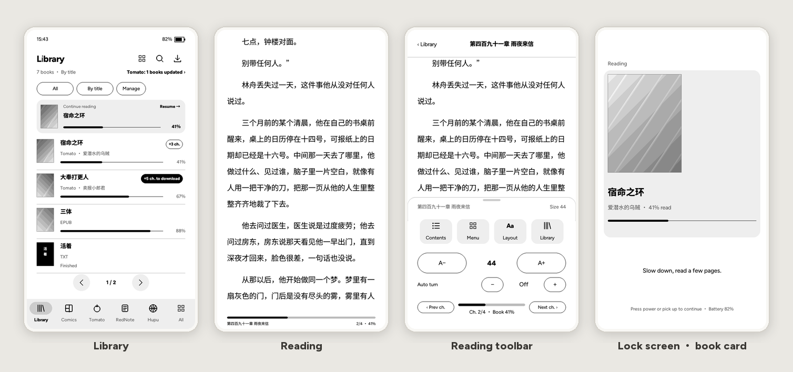
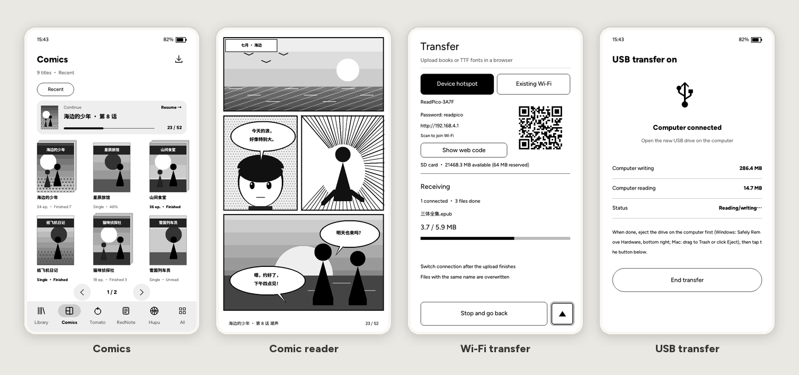
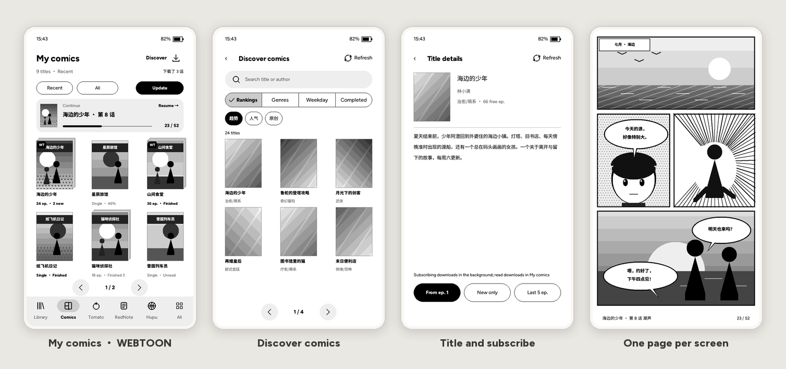
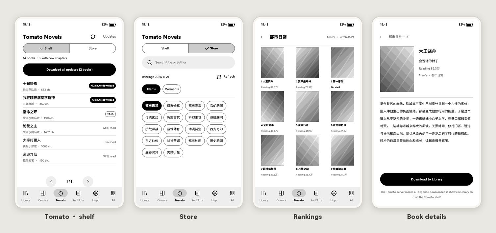
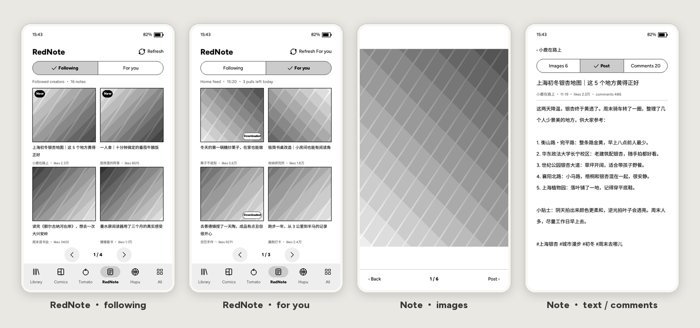
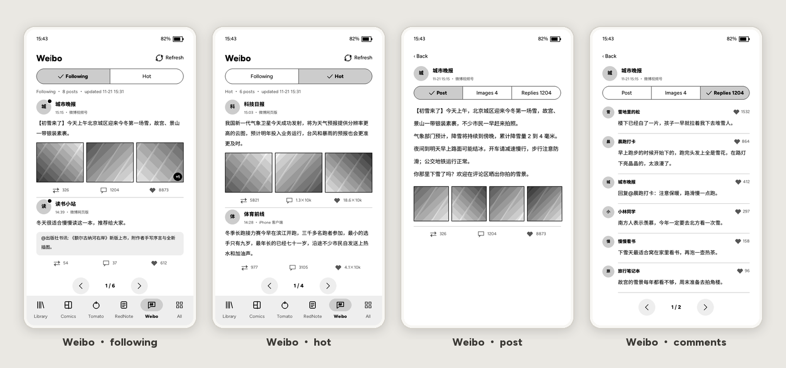
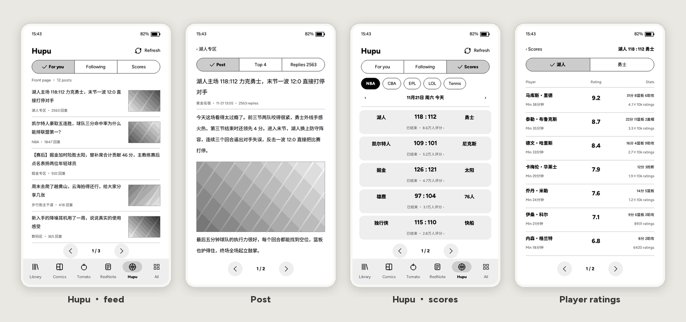
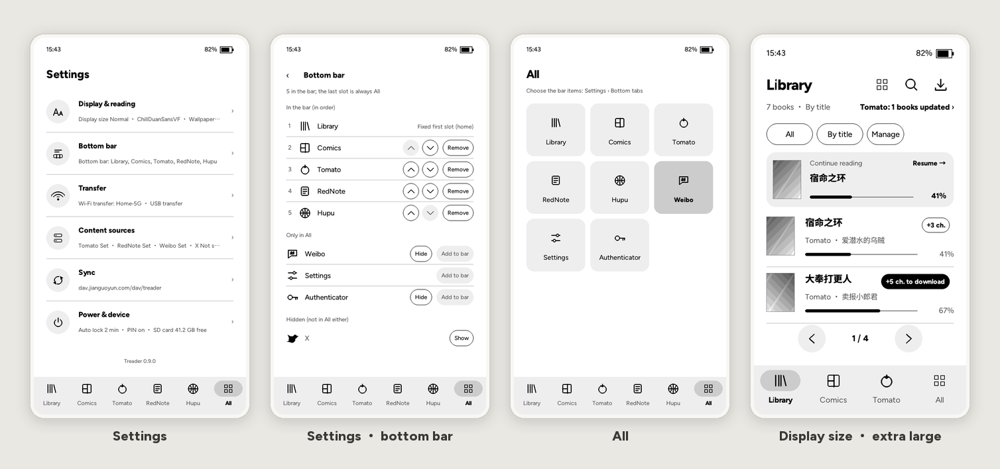
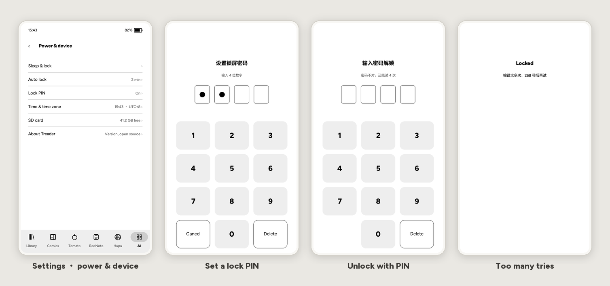
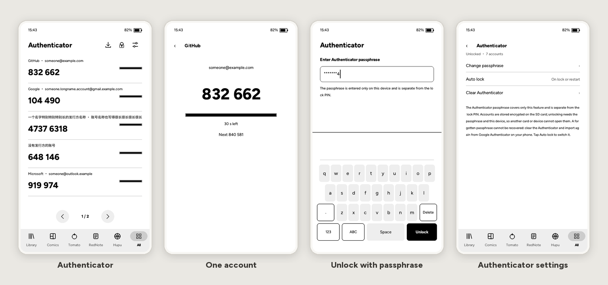

[中文](README.md) | **English**

# Treader


[](LICENSE)

**Treader is an e-ink reading firmware for the Read Pico**: local TXT / EPUB reading, CBZ comics, Tomato (Fanqie novels) search, download and updates, a Tomato ranking-based Store, Hupu browsing, RedNote and Weibo browsing through self-hosted servers, and WebDAV progress sync, all redesigned around the 4.7" 16-gray e-ink panel and the performance of the ESP32-S3.

It is based on MindReset's official [Read Pico demo firmware](https://github.com/MindReset/read_pico_firmware). The demo pages were replaced with a complete reading system, and it ports the core features of the Android [Tomato-Novel reader](https://github.com/bidabrain/Tomato-Novel) (without TTS) and the browsing part of [hupuX](https://github.com/bidabrain/hupuX).

It is more than firmware: Tomato, RedNote and Weibo each have an **Android app** ([tomato/android](tomato/android/README.md), [rednote/android](rednote/android/README.md), [weibo/android](weibo/android/README.md)) whose features and look follow the firmware (black, white and gray, paged instead of scrolled, the same layout), so a phone reads like an e-ink screen too. The Tomato app can also share reading progress and the bookshelf with the device over WebDAV.

> The device UI comes in two builds, Chinese and English. The Chinese-content features (Tomato, RedNote, Weibo, Hupu) serve Chinese-language content in either build.

> ⚠️ Unofficial firmware, not affiliated with MindReset or Fanqie Novel. Back up the original firmware before flashing.

## Features

**Reading**
- Library: TXT and EPUB files in `books/` on the SD card, shown as a list or a cover grid (toggle at the top right), sorted by title or recently read, searchable by pinyin initials, filterable by source (All / Local / Tomato)
- Image covers: EPUB's own cover, and Tomato books fetch their cover on download; shown in the Library and on the Lock screen
- Reader: table of contents, font size, per-book progress; layout options for line spacing, paragraph spacing, margins, first-line indent and per-line underlines; tap zones for turning pages can be left/right, center/bottom, or anywhere; one-tap previous / next chapter on the toolbar; partial DU fast refresh for page turns, periodic GC16 to clean the gray background, and a long press on the middle key for a full-screen refresh
- Timed auto page turn: available on the reading and comics toolbars, 3 to 30 seconds in 3-second steps; touching the screen restarts the timer, it stops on the last page, and the device does not auto-lock meanwhile
- The Library is the home page: the device boots straight into it; tap the "Continue reading" card at the top to pick up where you left off; with a Tomato server set, "Store" sits at the top right and the right of the status line offers "Check for updates" / "Download updates (N)". Two ways to Transfer books: upload from a web page over Wi-Fi, or connect a USB cable and use the SD card as a USB drive. Bottom tabs: the Library is always the first cell and "All" the last, with your favorite features in between (pick, order and hide them in Settings → Bottom tabs; X is hidden by default). The "All" page lists every feature: Library, Comics, RedNote, Hupu, Weibo, X, Settings, Authenticator (Tomato lives in the Library)

**Comics**

- Managed separately from the Library: CBZ files in `comics/` on the SD card; a subfolder is one series (episodes sorted naturally by file name), a single CBZ is a standalone volume
- Cover grid, "Continue", and the episode list of a series; one page per screen, tap left/right or swipe to turn, the next episode starts automatically when one ends, and right-to-left reading can be switched on
- When you upload through the Transfer web page, the phone browser first converts every page to a grayscale JPEG scaled to the screen (WebP and PNG work too; long vertical strips are cut into screens), about 1/5 of the original size, so pages turn fast on the device
- Each comic remembers the page you reached and the reading direction; long press to clear progress or delete
- WEBTOON Discover and follow-along (needs a self-hosted [webtoon server](webtoon/README.en.md)): tap "Discover" at the top right of My comics to browse rankings, genres, the weekday schedule and completed titles, or search; after you subscribe, "Check for updates" downloads new episodes as CBZ into My comics. The server converts the tall strips to grayscale and cuts screens in the blank gaps between panels, so pages turn as fast as local comics. My comics can be filtered by All / Local / WEBTOON, and subscriptions are tagged "WT" and "N new". When the server has Mihon extension sources enabled, the Discover page can switch to them as well. Only free public episodes are fetched; deploy it yourself, for your own use only

**Tomato (Fanqie novels)** (needs a [self-hosted download server](#self-hosted-tomato-download-server)), part of the Library with no tab of its own
- Entry: "Store" at the Library's top right; the Store's top bar is search
- Search: tap a result to see the synopsis, category, chapters and word count before deciding to download
- Download: the server generates a TXT that is saved into `books/` and read in the Library like any other book
- Checking for updates is separate from downloading: tap "Check for updates" on the right of the Library's status line, then "Download updates (N)" when there are new chapters; the same spot reads "Cancel" while it runs. Long-press a Tomato book and "Check this book" checks just that one and downloads its new chapters. Both run only when you tap them, **there is no automatic checking**; the book you are currently reading is not replaced
- Store: reads the [FanqieRankTracker](https://github.com/bidabrain/FanqieRankTracker) rankings, 37 categories for male and female readers, shown as a cover grid, with downloads straight from the detail page; when GitHub Pages times out from mainland China it automatically falls back to a jsDelivr mirror
- Every list is paged: tap a button or swipe once to turn a whole page, the e-ink screen never scrolls
- There is also a standalone Android app with the same features as the firmware Library (Tomato included) (search, download, Store, reading, progress shared with the device over WebDAV), see [tomato/android](tomato/android/README.md)

**Hupu** (read-only, no server needed, ported from the Android [hupuX](https://github.com/bidabrain/hupuX))
- Recommended: the front-page recommendations, 5 per page, with thumbnails
- Following: follow boards on the device (no sign-in), with the latest posts of all followed boards mixed together; browse all boards by category, and sort a board's posts by latest reply or latest post
- Scores: schedules for NBA, CBA, Premier League, LOL and tennis, today by default; finished games show full player ratings and box scores
- Posts: the body is paged, images sit inline, and tapping an image shows it full screen; "lit" hot replies and the earliest replies
- Goes online only when you tap "Refresh" or open something not yet cached; offline, the cache still works
- No sign-in, no "lighting", no replies, no ratings; videos only show a hint to watch them in the app

**RedNote** (read-only, needs a self-hosted [rednote server](rednote/README.en.md); the device never contacts RedNote directly)
- Following: image posts from the creators you follow, fetched by the server on a schedule, 4 per page with covers, new ones tagged "New"
- Recommended: the server reads the home feed once only when you tap "Refresh recommendations", with videos already filtered out; the number of fetches and the interval are limited in the server panel
- Notes: first the images, one per screen (already converted to grayscale and scaled to the screen by the server), then the text and the first 20 comments
- Enter the server address and token from a phone web page (Settings → Content sources → RedNote → Fill in from phone)
- The followed creators in the server panel can be backed up and restored with WebDAV
- There is also a standalone Android app with the same features as the firmware RedNote tab, see [rednote/android](rednote/android/README.md)

**Weibo** (read-only, needs a self-hosted [weibo server](weibo/README.en.md); no Weibo sign-in, and the device never contacts Weibo directly)
- Following: image posts from the people you follow, fetched by the server on a schedule and merged into one timeline; one post per row with author, time, the first three lines of text, reposts / comments / likes, a thumbnail when there are images, and new ones tagged "New"
- Hot: the server reads the hot list once per round and keeps only posts with images
- Posts: the full text first (long posts are completed, reposts include the original), then the images further on (one per screen), then the comments (the server fetches them the first time you open the post)
- Enter the server address and token from a phone web page (Settings → Content sources → Weibo → Fill in from phone)
- There is also a standalone Android app with the same features as the firmware Weibo tab, see [weibo/android](weibo/android/README.md)

**X** (read-only, hidden by default, turn it on in Settings → Bottom tabs; needs a self-hosted [x server](x/README.en.md); the device never contacts X directly)
- For You and Following: a browser on the server signs in to your X account (sign in by hand over VNC from the panel) and fetches at random intervals, not during the sleep window, with ads removed
- Cards are laid out like Weibo: under the name are the @handle, who reposted it, and who it replies to; quoted posts sit in a gray box, and videos keep only their cover
- Posts: the full text first, then the images further on (one per screen), then the replies (the server fetches them the first time you open the post)
- When "Following" is turned off in the server panel, that tab is grayed out and cannot be tapped on the device and in the app
- Enter the server address and token from a phone web page (Settings → Content sources → X → Fill in from phone)
- There is also a standalone Android app with the same features as the firmware X tab, see [x/android](x/android/README.md)

**Authenticator** (offline two-step verification codes, no server needed)
- Produces the same codes as Google Authenticator on your phone (TOTP, RFC 6238); keep GA on your phone as a backup
- Accounts are stored encrypted on the SD card; unlocking needs the Authenticator passphrase plus a random secret kept in this device, so a different card or a different device cannot decrypt them; eFuse is not touched
- Locking the screen, rebooting or removing the card all lock it; too many wrong passphrases make you wait
- Import: the device starts its own hotspot; on the phone web page pick a photo of the GA export QR code, paste an otpauth link, or type the secret by hand, then confirm on the device to save it; long press an account to delete it
- When the clock may be wrong, it reminds you to connect to Wi-Fi to sync the time; the passphrase, auto-lock and wipe are in Settings → Content sources → Authenticator, details in [docs/TREADER.md](docs/TREADER.md#验证器)
- There is also a standalone Android app with the same features as the firmware Authenticator tab, which can also send accounts straight to the Read Pico (no need to photograph the GA export screen with a second phone), see [auth/android](auth/android/README.md)

**Transfer**
- Wi-Fi Transfer: over the device hotspot or an existing Wi-Fi network, upload books, fonts and comics from a browser
- USB Transfer: connect a cable to a computer and copy files straight onto the SD card as a USB drive; the device pauses during the transfer and restarts afterwards. Normally the cable is still a serial port, so flashing works as usual

**System**
- Settings come in seven groups: Wi-Fi, Display & reading, Bottom tabs, Transfer, Content sources, Sync, Power & device. Wi-Fi keeps only one network; joining a new one replaces it
- Display size: Normal / Large / Extra large (100% / 115% / 130%), enlarging text, icons and buttons like Android does; the reading body font size is set separately
- Pinyin input method: full pinyin, T9, English and symbols, with an offline dictionary on the SD card
- Lock screen: a book card (the book you are reading and its progress) or a wallpaper from `wallpapers/` on the SD card; pick, preview full screen and delete images in Settings; when viewing a large image in RedNote, Weibo or X you can "Save as wallpaper" directly
- Auto-lock: 1, 2, 5 or 10 minutes, or never; lock passcode: 4 digits, off by default; once on, it is required at boot and on every unlock
- WebDAV: syncs reading progress and the Tomato bookshelf (Jianguoyun, Nextcloud and so on), only when you tap "Sync now"
- SD card management: status, remount, and a two-step-confirmed format (which recreates the folders afterwards)
- Removing the card does not crash the device, and a reinserted card is mounted automatically; **books, images and caches live only on the SD card**, the system flash holds only the firmware and settings
- Online update: in "About Treader → System update", check GitHub for the latest version; it is downloaded to the SD card first (resumable) and written only after it passes verification
- SD card update: put the new firmware in `update/` and update from "About Treader"; there are two 7 MB app slots, and if the new firmware fails to boot the device rolls back to the old one
- Time and time zone: automatic time sync by default (SNTP when online), Beijing time; you can also turn automatic sync off and set the time by hand, or switch to one of a dozen or so time zones such as Tokyo, London or New York. The time is kept in the power-management chip's RTC and survives power loss
- When going online fails, the message gives the exact reason (Wi-Fi, DNS, HTTPS, timeout, HTTP status), see [Network troubleshooting](#network-troubleshooting)
- Transfer and comic uploads keep a reserve free on the SD card (the larger of 100 MB and 5% of the card), so the card never fills up

## Screenshots

Screenshots drawn on a computer at the device's pixel size (684×1216) with the firmware's real UI code (`tools/page_render`). The content is demo data; image covers and photos are shown as gray gradients.

**Library and reading**



**Comics and Transfer**



**Discover comics (WEBTOON)**



**Tomato and the Store**



**RedNote**



**Weibo**



**Hupu**



**Settings, All, and display size**



**Auto-lock and lock passcode**



**Authenticator**



Every screen and what each page does: [docs/design/ui.html](docs/design/ui.html) (download it and open it in a browser; every screen is a screenshot drawn with the real UI code).

## Hardware

| Item | Spec |
| --- | --- |
| Device | Read Pico (RDP-G01-W) |
| SoC | ESP32-S3, 16 MB flash, 8 MB PSRAM |
| Screen | 4.7" e-ink, 1216 × 684, 16 gray levels, touch |
| Storage | SD card (FAT32; books and resources all live here) |

For the full hardware table, pinout and low-level components, see the original README of the official firmware: [docs/official/README.zh-CN.md](docs/official/README.zh-CN.md).

## Quick start

### 1. Prepare the SD card

Format it as FAT32 and copy **everything** in the repository's [`sdcard/`](sdcard/README.md) folder to the root of the card, and the layout is complete. If you would rather not download the whole repository, `treader-<version>-sdcard.zip` in [Releases](https://github.com/bidabrain/treader-eink/releases/tag/treader-latest) has the same content (shared by the Chinese and English builds); unzip it and copy everything inside (the flashing web page also has an "SD card files" button):

| Path on the card | Source | Notes |
| --- | --- | --- |
| `fonts/` | repo `sdcard/fonts/` | Chinese font (ChillDuanSans, 16 MB), **required**, otherwise book titles and text will have missing characters |
| `ime/` | repo `sdcard/ime/` | Pinyin dictionary (about 1 MB), required for typing Chinese |
| `books/` | your own | TXT, EPUB; books downloaded from Tomato go here too |
| `comics/` | your own or web upload | CBZ comics; put all episodes of one comic in the same subfolder. Web uploads are converted automatically; files you copy in yourself must contain JPEG / PNG images |
| `wallpapers/` | your own | Lock screen wallpapers, JPG/PNG, at most 2 MB each, 684×1216 portrait recommended |
| `tomato/config.json` | optional | Server, WebDAV and ranking addresses; can also be filled in under Settings on the device |
| `hupu/` | generated | Hupu cache for recommendations, posts, boards, schedules, ratings and images, size-capped and safe to delete entirely; `follow.json` holds the followed boards |

The device generates the bookshelf and Store cache under `tomato/` and the cover and wallpaper cache under `.treader/` by itself (safe to delete entirely). If Treader is already flashed, you can also format the card in "Settings → Power & device → SD card", which creates the folders above.

### 2. Build

Requires [ESP-IDF v6.1](https://docs.espressif.com/projects/esp-idf/):

```bash
idf.py set-target esp32s3
idf.py build
```

To build your own Tomato server into the firmware (similar to `local.properties` in the Android app), see [Built-in default server](#built-in-default-server-optional).

**Don't want to build it yourself**: GitHub Actions builds the firmware after every change and publishes it to [Releases](https://github.com/bidabrain/treader-eink/releases): the "latest build" (`treader-latest`) is always current, and each new version number also gets its own `treader-v<version>`. It uses the same configuration as the real device and can be flashed directly. For the English UI, use `treader-<version>-full-en.bin` for a first flash or when the partition table changes, and `treader-<version>-upgrade-en.bin` to upgrade (the Chinese builds are `treader-<version>-full.bin` / `treader-<version>-upgrade.bin`); `treader-<version>-sdcard.zip` holds the font and pinyin dictionary to put on the SD card on first flash, shared by both languages. These builds **have no built-in Tomato server**: to use Tomato, first [set up your own download server](#self-hosted-tomato-download-server), then enter its address and password on the device under "Settings › Content sources › Tomato"; the Store uses the FanqieRankTracker rankings by default. The flashing web page also has download buttons.

The English firmware's online update only installs English packages, and the Chinese firmware only Chinese ones. To switch language, flash the other build; an upgrade package keeps your settings and progress.

### 3. Flash

**Option A: flash from the web (no tools to install)**

Open [bidabrain.github.io/treader-eink](https://bidabrain.github.io/treader-eink/) in Chrome or Edge on a computer, drag in the `build/treader-full.bin` you built (or a downloaded `treader-<version>-full-en.bin`), choose "Upgrade" or "Full install", and connect the device to start. The firmware is read only on your computer and never uploaded; the page writes it in segments by address and by default leaves the settings area alone, so Wi-Fi and reading progress are kept. The page source is in [`site/`](site/index.html).

**Option B: command line**

Connect the device over USB-C. Before the first flash, back up the original firmware (the whole 16 MB):

```bash
python -m esptool --port COM5 read-flash 0 0x1000000 pico-backup.bin
```

Flash and watch the log (`Ctrl+]` to exit):

```bash
idf.py -p COM5 flash monitor
```

- Upgrading from the official factory firmware needs no erase, and settings such as Wi-Fi are kept. Coming from another third-party firmware, erase the whole chip first: `idf.py -p COM5 erase-flash flash monitor`.
- **Do not use esptool to write a merged image (the single file produced by `merge-bin`) from 0x0 in one go**: the gaps in it overwrite the settings partition (NVS), wiping Wi-Fi and reading progress, and the boot selection area is not reset. On the command line use `idf.py flash` (it also writes `ota_data_initial.bin`); leave merged images to the web flasher, which writes them in segments.
- The Read Pico **has no BOOT button**, and you don't need to press any key: the flashing tool puts the device into download mode over USB automatically. The device must be powered on first (USB does not work after choosing "Power off" from the Lock screen).
- If it won't connect, try in order: a different cable that carries data (an official recommendation is USB-A to C); close programs holding the serial port (serial monitors, other flashing pages); unplug and replug USB; put the device to sleep and wake it once, or power it off and on. On Windows write the port as `COM5`, not `\\.\COM5`.

Generate a merged image like this (for the web flasher):

```bash
cd build
python -m esptool --chip esp32s3 merge-bin -o treader-full.bin --flash-mode dio --flash-freq 80m --flash-size 16MB 0x0 bootloader/bootloader.bin 0x8000 partition_table/partition-table.bin 0x10000 Read_Pico.bin
```

### Later upgrades: online or SD card

Once Treader is installed, you no longer need a computer. Both methods are under Settings → Power & device → About Treader → tap the "Version" row (the System update page).

**Online update** (the public releases on GitHub):

1. Tap "Check for updates". The device joins a saved Wi-Fi network and reads the version number of the "latest build" (`treader-latest`) on GitHub.
2. If the online version is newer, it shows "Found x.y.z"; tap "Download and update". The same version shows "Up to date", with "Reinstall" available if needed; if the current version is newer (your own build), nothing is offered.
3. The package is first downloaded to `update/` on the SD card with a progress bar; if the network drops it resumes automatically, and if you leave the page and come back the button becomes "Resume download". It is written only after both the size and SHA-256 check out, then the device restarts; once the new version is up, the downloaded package is deleted automatically. The English build fetches the `-en` package and the Chinese build the Chinese one.

An SD card must be inserted (with enough free space for the package). Public releases have no built-in Tomato server: if you are running your own build with a built-in server, you are warned once before upgrading; a server entered in Settings is not affected.

**SD card update** (firmware you built yourself):

1. Change `PROJECT_VER` in `CMakeLists.txt` (so you can tell old from new on the device) and build.
2. Copy `build/Read_Pico.bin` (or `treader-full.bin`) to the `update/` folder on the SD card.
3. On the System update page, pick the file from the "SD card update" list → start the update.

Writing takes about a minute, then the device restarts; settings, progress and books are kept. Updating is refused when the battery is below 30% and not charging. The new firmware is written to the other app slot, and if it fails to boot the device rolls back to the current version.

### 4. First boot

1. Insert the SD card and power on; you land in the Library.
2. Settings → Display & reading → Font, choose ChillDuanSans.
3. Settings → Transfer → Wi-Fi Transfer, join a 2.4 GHz network (you can also send books to the device from a browser here).
4. Settings → Content sources → Tomato server, enter your server address and password (if one is built into the firmware it shows "Built-in server").
5. Library → "Store" at the top right → search for a book and try downloading it. The clock is synced the first time the device goes online.

## Keys

Three touch keys below the screen, plus the power key on the side:

| Key | Most pages | While reading |
| --- | --- | --- |
| Left | Back one level | Previous page |
| Middle (home) | Short press returns to the Library; **hold 0.5 s for a full-screen refresh** (clears ghosting) | Short press toggles the reading toolbar; hold for a full-screen refresh |
| Right | Opens the "All" page (pages through it there; pressing on the last page returns to where you were) | Next page |
| Power | Short press locks the screen (choose light sleep, deep sleep or power off in Settings → Power & device → Sleep & lock; the auto-lock time and the 4-digit lock passcode are on the same page). If it won't wake, hold for 10 seconds to force power off, then hold about 1 second to power on | Same as left |

In the Library, a short press on the middle key returns to the first page, and on the first page it does a full-screen refresh; on the System update and device self-test pages a short press also only refreshes, so it never interrupts an operation in progress.

## Self-hosted Tomato download server

Treader does not call Fanqie's content API directly: searching and generating TXT files are handled by a [Tomato-Novel-Downloader](https://github.com/zhongbai2333/Tomato-Novel-Downloader) you deploy yourself (Web UI server mode); the device only sends requests and downloads the result. This is the same server the Android Tomato reader uses, so **one server can serve both the Android app and Treader**.

The Store rankings do not go through this server, so you can browse them without it, but downloading needs it.

### Deploy

**One-step deployment (recommended)**: this repository's [`tomato/`](tomato/README.en.md) packages the official downloader and a panel into one compose file. After `docker compose up -d`, the web panel shows status, sets the device password and starts a Cloudflare tunnel; books are stored on the host, and the default format is set to TXT automatically. The address and API for the device and the Android app are the same as using the official downloader directly:

```bash
mkdir tomato && cd tomato
curl -fsSLO https://raw.githubusercontent.com/bidabrain/treader-eink/main/tomato/docker-compose.yml
docker compose up -d
```

Then open `http://<server IP>:18423`; see [tomato/README.en.md](tomato/README.en.md) for details. Below are ways to run the official downloader directly without the panel. Pick one; all of them must enable **Web UI server mode** (`--server`) and **set a password**. In the commands below, `你的密码` means "your password": replace it with your own.

**Docker (the official image directly)**

```bash
docker run -d \
    --name tomato-novel-webui \
    --restart unless-stopped \
    -p 18423:18423 \
    -v /host/data:/data \
    -e TOMATO_WEB_ADDR=0.0.0.0:18423 \
    -e TOMATO_WEB_PASSWORD=你的密码 \
    zhongbai233/tomato-novel-downloader-webui:latest --server --data-dir /data
```

On soft routers, NAS boxes and other lightweight systems, use the `latest-musl` image. Replace `/host/data` with the host directory for configuration and books.

**Run directly (Windows / Linux / macOS / Android Termux)**

Download the program for your system from [Releases](https://github.com/zhongbai2333/Tomato-Novel-Downloader/releases), then:

```bash
TOMATO_WEB_ADDR=0.0.0.0:18423 TOMATO_WEB_PASSWORD=你的密码 ./TomatoNovelDownloader --server
```

On Windows, run the downloaded `.exe` from the command line with `--server --password <your password>`, and set the environment variable `TOMATO_WEB_ADDR=0.0.0.0:18423`. On Linux / macOS / Termux you can also install with the author's one-line script; see that project's documentation.

Key points:

- **Listen address**: by default it only listens on the local machine (`127.0.0.1:18423`), which the device cannot reach. You must set `TOMATO_WEB_ADDR=0.0.0.0:18423`.
- **Password**: `TOMATO_WEB_PASSWORD` or `--password`. Treader sends it in the `x-tomato-password` request header.
- **Download format**: Tomato books on the device always use TXT (updates only append chapters, so reading progress carries over smoothly). When the server asks for a format, the device picks TXT automatically; if you pinned the default format to EPUB on the Web UI's configuration page, change it back to TXT or "Ask every time". This only affects Tomato downloads; EPUBs you put in `books/` yourself read as usual.
- **Sub-path**: when deployed under a sub-path with `TOMATO_WEB_BASE_PATH=/tomato`, the address on the device must include it too, for example `https://example.com/tomato`.

### Making it reachable from the device

| Scenario | Address to enter on the device | Notes |
| --- | --- | --- |
| Home only | `http://192.168.1.10:18423` | Server and device are on the same LAN; enter the server's LAN IP |
| Away from home too | `https://<your domain>` | Add HTTPS with Nginx / Caddy / Cloudflare or similar; **the certificate must be issued by a proper CA** (such as Let's Encrypt or Google Trust Services) |

- The device verifies HTTPS certificates, so **self-signed certificates will not connect**. Certificate chains ending in a cross-signed root, like Cloudflare's, are supported.
- When a domain resolves to a private IP, some routers with "DNS rebinding protection" drop the answer; if resolution fails, the device automatically retries once with the Alibaba / Tencent public DNS.
- The device only joins 2.4 GHz Wi-Fi.
- If you expose it to the internet, always keep the password on, and preferably add rate limiting on the reverse proxy.

### Self-check

After deploying, confirm the server works from a computer before entering it on the device.

1. **Open the Web UI**: visit `http://<server IP>:18423/` in a browser; if you can log in with the password and a search returns results, the server itself is fine.
2. **Test the API the device uses**: on another computer (not the server itself, to confirm the LAN can reach it), run the command below; the value after `q=` is the URL-encoded title "诡秘之主" (Lord of the Mysteries), and `你的密码` is your password:

   ```bash
   curl -H "x-tomato-password: 你的密码" "http://服务器IP:18423/api/search?q=%E8%AF%A1%E7%A7%98%E4%B9%8B%E4%B8%BB"
   ```

   (`服务器IP` is the server IP.)

   | Result | Meaning |
   | --- | --- |
   | JSON containing `"items"` | Working; you can enter it on the device |
   | 401 / 403 | Wrong password |
   | Connection refused or timed out | Not listening on `0.0.0.0`, the port is not mapped, or a firewall is blocking it |
   | HTTPS certificate error | The certificate is not trusted, and the device will not connect either |

3. **Try it on the device**: Settings → Content sources → Tomato server, enter the address and password → Library → "Store" at the top right → search for a book → download. On failure, the reason is in parentheses after the message; check it against [Network troubleshooting](#network-troubleshooting).

The API the device uses (same as the Android app): `GET /api/search`, `POST /api/jobs`, `GET /api/jobs?id=`, `GET /api/library?name=`, `GET /download/<path>`, and `GET /api/updates` for checking updates. For details, see the [download server API notes](https://github.com/bidabrain/Tomato-Novel#下载服务器-api-说明) in the Android app's README (Chinese).

### Configuring the device

Three ways, from highest to lowest priority:

1. **On the device**: Settings → Content sources → Tomato server, type the address and password with the keyboard. Leaving the address empty falls back to the built-in server.
2. **SD card**: `tomato/config.json`, format as in [`sdcard/tomato/config.example.json`](sdcard/tomato/config.example.json) (`你的密码` is your server password, `应用密码` your WebDAV app password):
   ```json
   {
     "server": "http://192.168.1.10:18423",
     "password": "你的密码",
     "store_url": "",
     "webdav_url": "https://dav.jianguoyun.com/dav/treader",
     "webdav_user": "you@example.com",
     "webdav_password": "应用密码"
   }
   ```
3. **Built into the firmware**: see the next section.

### Built-in default server (optional)

As with the Android app, you can create `local.properties` in the project root (already in `.gitignore`, never committed). The comment line means "Store ranking site, optional":

```properties
DOWNLOADER_URL=https://你的服务器
DOWNLOADER_PASSWORD=你的密码
# 书城榜单网站，可省略
STORE_URL=https://bidabrain.github.io/FanqieRankTracker
```

If the build prints `Treader: built-in Tomato server enabled`, it took effect. A server entered in Settings takes precedence; otherwise the built-in one is used. The UI only shows "Built-in server", never the address or password.

> The address and password are stored obfuscated in the firmware, so tools like `strings` won't find them, but anyone versed in reverse engineering can still recover them, just as with an Android APK. **Firmware with a built-in server is for your own use only; do not publish it.** Leave the `local.properties` fields empty or delete them, and the resulting firmware has no built-in server.

## Store rankings

The Store's data is the Fanqie category ranking JSON on the [FanqieRankTracker](https://github.com/bidabrain/FanqieRankTracker) site (scraped periodically by GitHub Actions and published on GitHub Pages). The default address is `https://bidabrain.github.io/FanqieRankTracker`.

- To use your own rankings: fork that repository and turn on GitHub Pages, then enter your site address in Settings → Content sources → Tomato → Store rankings (or set `STORE_URL` in `local.properties`). The `.../api/lastest/all.json` address used by the Android app also works; it is trimmed to the site root automatically.
- The device fetches data per category (about 55 KB each), caches it in `tomato/store/` on the SD card, and only goes online again when you tap "Refresh".
- From mainland China, direct connections to `*.github.io` often time out. When the address is `https://<user>.github.io/<repo>`, after a failure the device tries `https://{fastly,gcore,cdn}.jsdelivr.net/gh/<user>/<repo>@main` in turn (reading the `api/lastest/` committed on the repository's main branch) and remembers the one that works until reboot. jsDelivr caches branch content for up to 12 hours, so rankings seen through the mirror can lag by half a day. From mainland China it is better to enter the gh-proxy address `https://gh-proxy.com/https://raw.githubusercontent.com/bidabrain/FanqieRankTracker/main` directly in Settings → Content sources → Tomato → Store rankings (a free third-party proxy relaying the repository files, only minutes behind; with it set the device no longer falls back to jsDelivr), and switch back to `https://cdn.jsdelivr.net/gh/bidabrain/FanqieRankTracker@main` if it stops working.

## Network troubleshooting

When going online fails, the text in parentheses after the message tells you which step failed:

| Reason in the message | Meaning | What to do |
| --- | --- | --- |
| Wi-Fi not set up | No network configured yet | Settings → Transfer → Wi-Fi Transfer |
| Wrong password or weak signal | Cannot join the Wi-Fi | Check the password; the device supports 2.4 GHz only |
| Connected but no IP | The router did not assign an address | Restart the router or try another network |
| Transfer is still using Wi-Fi | The Transfer page is still open | Leave the Transfer page and try again |
| DNS lookup failed | Neither the router nor public DNS resolved it | Check the spelling of the address; for a LAN server you can enter `http://<LAN IP>:<port>` directly |
| HTTPS handshake failed | Certificate not trusted or protocol incompatible | Use a certificate from a proper CA; on a LAN you can just use http |
| Server connection timed out / cannot reach server errno N | Got an address but cannot connect | Check that the server is up, the port and the firewall; sites outside China may be blocked |
| HTTP 401 / 403 | Wrong password | Check the Tomato server password |
| HTTP 404 | Wrong address | Check whether a sub-path is missing |

Wi-Fi uses the Chinese channel plan (1 to 13). The device uses IPv4 only; when a computer can open an address but the device cannot, the usual cause is that the computer is going through IPv6, a proxy or an accelerator.

## WebDAV sync

Runs only from Settings → Sync → Sync now, and syncs **reading progress** and the **Tomato bookshelf**; book files themselves are not transferred. It syncs between Treader devices and does not share data with the Android Tomato-Novel reader's WebDAV. Jianguoyun needs an "app password", not your login password. The merge rules are in [docs/TREADER.md](docs/TREADER.md#webdav-同步).

## Flash partitions

| Partition | Address | Size | Purpose |
| --- | --- | --- | --- |
| nvs | 0x9000 | 20 KB | Settings, Wi-Fi, reading progress |
| phy_init | 0xE000 | 4 KB | RF calibration |
| ota_0 | 0x10000 | 7 MB | App slot 1 (the firmware is currently about 3 MB) |
| ota_1 | 0x710000 | 7 MB | App slot 2, written by online or SD card updates; the two slots take turns |
| otadata | 0xE10000 | 8 KB | Records which slot to boot |
| unallocated | 0xE12000 | about 1.9 MB | Reserved |

Compared with the official firmware, NVS has not moved, so settings can be kept when switching to this partition table from the official firmware or an older Treader, but you must use "Full install" (which writes the new partition table), not just "Upgrade". Books and images are never stored in the internal flash.

## Documentation

| Document | Contents |
| --- | --- |
| [docs/design/ui.html](docs/design/ui.html) | Mockups of every screen and what each page does (the single design document) |
| [docs/TREADER.md](docs/TREADER.md) | Treader behavior details, SD card layout, module responsibilities, known limits |
| [rednote/README.en.md](rednote/README.en.md) | RedNote content server: Docker deployment, web panel, Cloudflare Tunnel; the device's RedNote tab reads from it |
| [tomato/README.en.md](tomato/README.en.md) | One-step Tomato download server deployment: the official downloader + a panel (device password, Cloudflare Tunnel) |
| [weibo/README.en.md](weibo/README.en.md) | Weibo content server: no sign-in, Docker deployment, follow management, WebDAV backup; the device's Weibo tab reads from it |
| [x/README.en.md](x/README.en.md) | X content server: sign-in by hand over VNC, random intervals and a sleep window, Docker deployment; the device's X tab reads from it |
| [webtoon/README.en.md](webtoon/README.en.md) | WEBTOON Discover and follow-along server: reads free public WEBTOON episodes, converts to grayscale, cuts screens and packs CBZ, keeps no subscriptions, Docker deployment; optional Mihon extension sources (Suwayomi runs the extensions; no repository is provided); the device's Discover comics page reads from it |
| [docs/CHANGELOG.md](docs/CHANGELOG.md) | Release changes |
| [AGENTS.md](AGENTS.md) | Code conventions: page contract, comment style, frozen product decisions |
| [docs/official/](docs/official/README.zh-CN.md) | Original README of the official demo firmware: hardware table, pinout, low-level components |

## Acknowledgements

| Project | Used for |
| --- | --- |
| [MindReset/read_pico_firmware](https://github.com/MindReset/read_pico_firmware) | Official demo firmware, the foundation of Treader (Apache-2.0) |
| [RickyOS](https://dot.mindreset.tech/docs/read_0/start/rickyos) (Ricky AI Studio, [GitHub](https://github.com/chinoryunqin/RickyOS)) | Reference for the system UI style: status bar, bottom tabs, hairlines and whitespace in the layout |
| [Take Easy](https://take-easy.pages.dev/) ([GitHub](https://github.com/takeeasy-cui/take-easy-firmware)) | Reference for feature ideas: lock screen wallpapers, image covers, web flashing, SD card updates |
| [vroland/epdiy](https://github.com/vroland/epdiy) | E-ink driver (LGPL-3.0) |
| [zhongbai2333/Tomato-Novel-Downloader](https://github.com/zhongbai2333/Tomato-Novel-Downloader) | Tomato novel download server |
| [bidabrain/Tomato-Novel](https://github.com/bidabrain/Tomato-Novel) | Android Tomato reader, source of the API usage and update rules |
| [bidabrain/hupuX](https://github.com/bidabrain/hupuX) | Android Hupu client, source of how the Hupu pages fetch data |
| [wen1701/FanqieRankTracker](https://github.com/wen1701/FanqieRankTracker) | Fanqie category ranking data |
| [XH View OS For Pico](https://github.com/XHFO/XH-View-OS-For-Pico) | Pinyin input engine and dictionary format (Apache-2.0) |
| jieba, pypinyin | Pinyin dictionary data (MIT) |
| ChillDuanSans (寒蝉端黑体) | Chinese font (SIL OFL-1.1) |
| [JPEGDEC](https://github.com/bitbank2/JPEGDEC) (BitBank Software) | Fast decoding of ordinary baseline JPGs, converting to grayscale and downscaling while decoding (Apache-2.0) |
| stb_truetype, stb_image, TJpgDec, cJSON | Font rendering, image decoding (other JPGs and PNG), JSON parsing |
| [jsQR](https://github.com/cozmo/jsQR) | QR code photo recognition on the Authenticator import page (Apache-2.0) |

RickyOS and Take Easy are both excellent systems from the Read Pico community. Treader only took inspiration from their design and feature ideas and uses none of their code.

## License

The code follows upstream's [Apache-2.0](LICENSE); `components/epdiy` is LGPL-3.0; the font is SIL OFL-1.1; third-party components follow their own licenses.

This project is for personal study and non-commercial use only. Downloaded novels are for your own reading; please follow Fanqie Novel's terms of service and your local laws.
