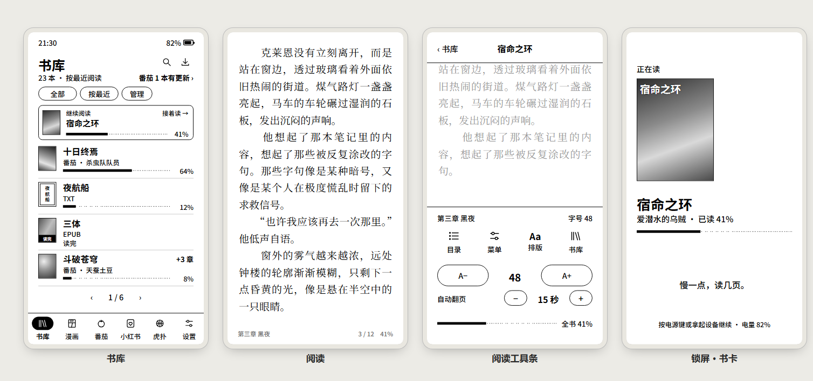
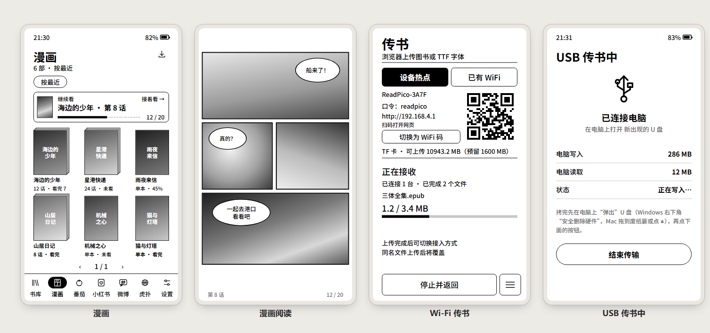
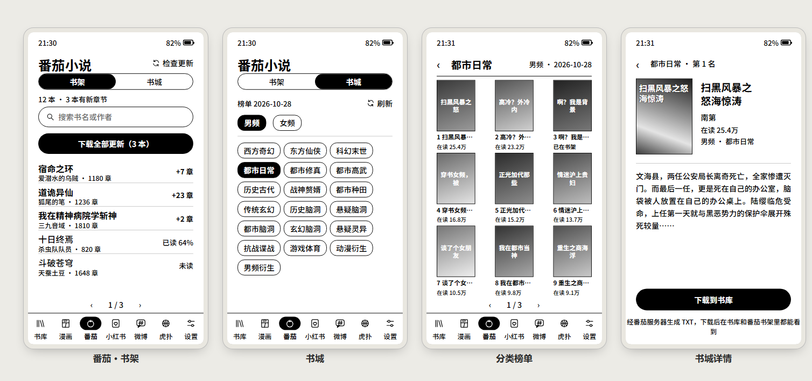
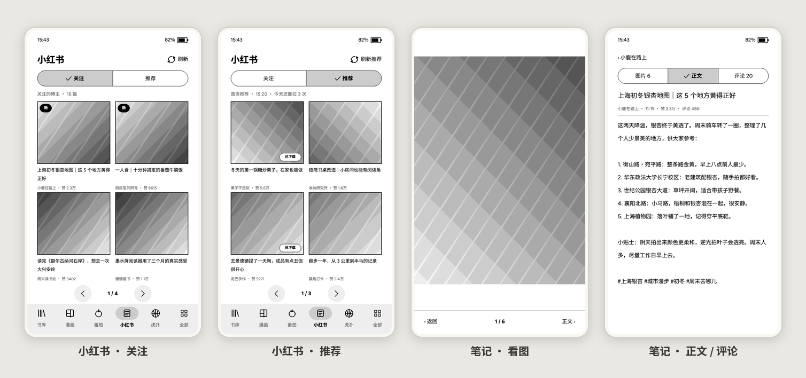
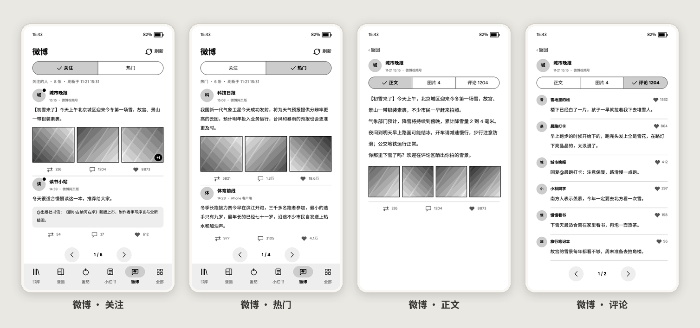
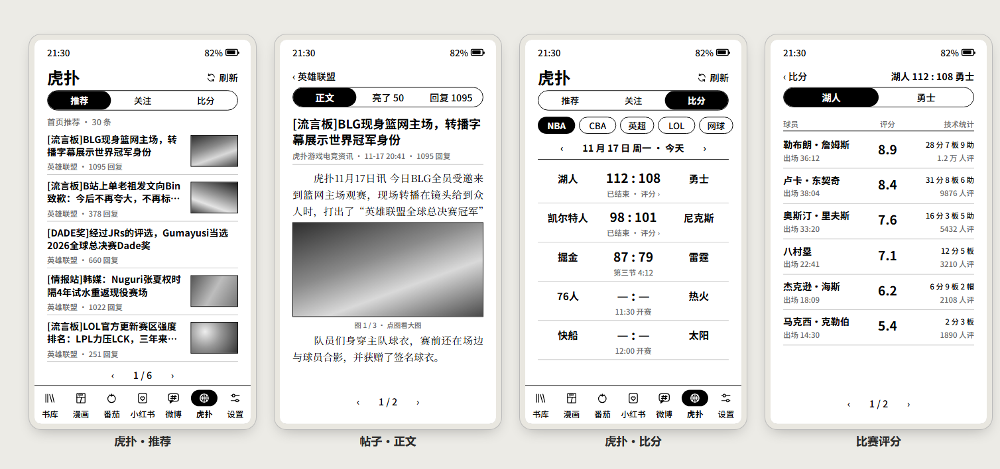
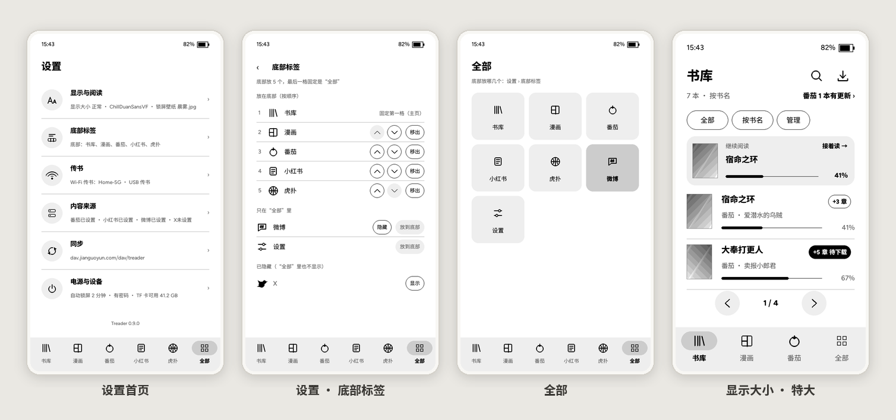

# Treader


[](LICENSE)

**Treader 是给小纸 Pico（Read Pico）用的墨水屏阅读固件**：本地 TXT / EPUB 阅读、CBZ 漫画、番茄小说搜索下载与更新、番茄榜单书城、虎扑浏览、经自建服务器的小红书和微博浏览、WebDAV 进度同步，全部为 4.7 寸 16 级灰度墨水屏和 ESP32-S3 的性能重新设计。

它基于 MindReset 官方的 [Read Pico 示例固件](https://github.com/MindReset/read_pico_firmware)，把演示页换成了一套完整的阅读系统，并移植了安卓版 [番茄阅读器 Tomato-Novel](https://github.com/bidabrain/Tomato-Novel) 的核心功能（不含 TTS）和 [虎扑 X](https://github.com/bidabrain/hupuX) 的浏览部分。

> Treader is an e-paper reading firmware for the Read Pico (ESP32-S3, 4.7" 16-gray panel): local TXT/EPUB reading, Tomato novel search, download and updates through a self-hosted server, a rank-based bookstore, read-only Hupu browsing, Xiaohongshu and Weibo through self-hosted servers, and WebDAV progress sync. It is built on MindReset's Read Pico demo firmware. The documentation is in Chinese.

> ⚠️ 非官方固件，与 MindReset、番茄小说没有隶属关系。刷机前请备份原固件。

## 功能

**阅读**
- 书库：TF 卡 `books/` 里的 TXT、EPUB，按书名或最近阅读排序，拼音首字母搜索，按来源筛选（番茄 / 其他书）
- 图片封面：EPUB 自带封面、番茄书下载时一起取封面；书库、锁屏都显示
- 阅读器：目录、字号、逐书记住进度；排版可调行距、段距、页边距、首行缩进和每行下划线；局部 DU 快刷翻页，周期性 GC16 压灰底，长按中键整屏刷新
- 定时自动翻页：阅读和漫画的工具条里都能开，3～30 秒、每档 3 秒；碰屏幕重新计时，翻到最后一页停下，期间不自动锁屏
- 书库就是主页：开机直接进书库，顶部“继续阅读”卡片点一下接着读，番茄有新章节时状态行提示；传书两种方式：Wi-Fi 网页上传，或 USB 线连电脑把 TF 卡当 U 盘；底部标签：书库、漫画、番茄、小红书、虎扑、微博、设置，最多同时显示七个（设置 → 底部标签里可以关掉中间五个）

**漫画**

- 和书库分开管理：TF 卡 `comics/` 里的 CBZ，一个子文件夹算一部系列（多话按文件名自然排序），单个 CBZ 算单本
- 封面网格、“继续看”、系列的话列表；一屏一页，左右点按或滑动翻页，一话看完自动接下一话，可切换从右往左
- 用传书网页上传时，手机浏览器先把每页转成灰度 JPEG、缩到屏幕大小（WebP、PNG 都行，太长的条漫按屏切开），体积约为原来的 1/5，设备翻页快
- 每部漫画记住看到第几页和翻页方向，长按可清进度或删除

**番茄小说**（需要[自建下载服务器](#自建番茄下载服务器)）
- 搜索：点结果先看简介、分类、章节、字数，再决定下载
- 下载：服务器生成 TXT 后存进 `books/`，在书库里像普通书一样阅读
- 检查更新与下载分开：都只在你点的时候运行，**不会自动检查**；正在读的那本不替换
- 书城：读取 [FanqieRankTracker](https://github.com/bidabrain/FanqieRankTracker) 榜单，男频 / 女频 37 个分类，封面网格显示，详情页直接下载；国内直连 GitHub Pages 超时会自动改用 jsDelivr 镜像
- 所有列表都按页显示，点按钮或滑一下翻一整页，墨水屏不做滚动
- 另有一个和固件书库、番茄标签功能相同的独立安卓 App（搜书、下载、书城、阅读，WebDAV 和设备互通进度），见 [tomato/android](tomato/android/README.md)

**虎扑**（只读，不需要服务器，移植自安卓版 [虎扑 X](https://github.com/bidabrain/hupuX)）
- 推荐：首页推荐，每页 5 条，带缩略图
- 关注：在设备上关注专区（不用登录），各专区最新帖子混排；全部专区按分类浏览，专区帖子可按最新回复或最新发布
- 比分：NBA、CBA、英超、LOL、网球的赛程，默认显示今天；已结束的比赛看全场球员评分和技术统计
- 帖子：正文分页显示，图片嵌在正文里，点图全屏看；“亮了”的热门回复和前面的回复
- 只在点“刷新”或打开没缓存的内容时联网；不联网时照常看缓存
- 不登录、不点亮、不回复、不打分；视频只提示去 App 看

**小红书**（只读，需要自建 [rednote 服务器](rednote/README.md)，设备不直接访问小红书）
- 关注：服务器定时拉好的关注博主图文，每页 4 篇带封面，新到的标“新”
- 推荐：点“刷新推荐”时服务器才去读一次首页，视频已滤掉；次数和间隔在服务器面板里限制
- 笔记：先一屏一张看图（服务器已转成灰度、缩到屏幕大小），再看正文和前 20 条评论
- 服务器地址和令牌用手机网页填写（设置 → 内容来源 → 小红书 → 手机网页填写）
- 服务器面板里关注的博主可以用 WebDAV 备份和恢复
- 另有一个和固件小红书标签功能相同的独立安卓 App，见 [rednote/android](rednote/android/README.md)

**微博**（只读，需要自建 [weibo 服务器](weibo/README.md)，不用登录微博，设备不直接访问微博）
- 关注：服务器定时拉好的关注的人的图文微博，合成一条时间线；一行一条，作者、时间、正文前三行、转评赞，有图的带缩略图，新到的标“新”
- 热门：服务器每轮读一次热门榜单，只留图文
- 微博：先看全文（长微博已补全，转发的接原文），往后翻是图片（一屏一张），再往后是评论（第一次打开时服务器才去取）
- 服务器地址和令牌用手机网页填写（设置 → 内容来源 → 微博 → 手机网页填写）
- 另有一个和固件微博标签功能相同的独立安卓 App，见 [weibo/android](weibo/android/README.md)

**传书**
- Wi-Fi 传书：设备热点或已有 Wi-Fi，浏览器上传书、字体、漫画
- USB 传书：数据线连电脑，TF 卡当 U 盘直接拷；传输期间设备暂停，结束后重启恢复。平时插线还是串口，刷机照常

**系统**
- 设置分六类：显示与阅读、底部标签、传书、内容来源、同步、电源与设备
- 拼音输入法：全拼、九键、英文、符号，离线词库在 TF 卡上
- 锁屏：书卡样式（在读的书和进度）或 TF 卡 `wallpapers/` 里的壁纸，在设置里选图、全屏预览、删除；小红书和微博看大图时可以直接“存为壁纸”
- WebDAV：同步阅读进度和番茄书架（坚果云、Nextcloud 等），只在点“立即同步”时运行
- TF 卡管理：状态、重新挂载、两步确认的格式化（格式化后自动建好文件夹）
- 拔卡不崩，重新插卡自动挂载；**书、图片和缓存只存 TF 卡**，系统 flash 只放固件和设置
- TF 卡升级：把新固件放进 `update/`，在“关于 Treader”里升级；两个 7 MB 程序槽，新固件起不来自动退回旧版本
- 联网时用 SNTP 对时并写进电源管理芯片的 RTC，断电后时间仍在
- 联网失败时提示具体原因（Wi-Fi、DNS、HTTPS、超时、HTTP 状态），见[联网排查](#联网排查)
- 传书和上传漫画给 TF 卡留出预留空间（100 MB 和卡容量 5% 取大的），不会把卡写满

## 界面预览

按设备真实像素（684×1216）绘制的设计稿截图，图片封面和壁纸用灰度渐变示意。

**书库与阅读**



**漫画与传书**



**番茄小说与书城**



**小红书**



**微博**



**虎扑**



**设置**



全部界面和每个页面的功能：[docs/design/ui.html](docs/design/ui.html)（下载后用浏览器打开）。

## 硬件

| 项目 | 规格 |
| --- | --- |
| 设备 | 小纸 Pico（Read Pico，RDP-G01-W） |
| 主控 | ESP32-S3，16 MB flash，8 MB PSRAM |
| 屏幕 | 4.7 寸墨水屏，1216 × 684，16 级灰度，触摸 |
| 存储 | TF 卡（FAT32，书和资源都放这里） |

完整的硬件表、引脚和底层组件说明见官方固件的原版说明：[docs/official/README.zh-CN.md](docs/official/README.zh-CN.md)。

## 快速开始

### 1. 准备 TF 卡

格式化成 FAT32，把仓库 [`sdcard/`](sdcard/README.md) 文件夹里的**全部内容**复制到卡的根目录，结构就齐了：

| 卡上路径 | 来源 | 说明 |
| --- | --- | --- |
| `fonts/` | 仓库 `sdcard/fonts/` | 中文字体（寒蝉端黑体，16 MB），**必需**，否则书名和正文会缺字 |
| `ime/` | 仓库 `sdcard/ime/` | 拼音词库（约 1 MB），要输入中文就必需 |
| `books/` | 自己放 | TXT、EPUB；番茄下载的书也放这里 |
| `comics/` | 自己放或网页上传 | CBZ 漫画；一部漫画的多话放进同一个子文件夹。网页上传会自动转换，自己拷进来的要是 JPEG / PNG 图片 |
| `wallpapers/` | 自己放 | 锁屏壁纸，JPG/PNG，单张不超过 2 MB，建议 684×1216 竖图 |
| `tomato/config.json` | 可选 | 服务器、WebDAV、榜单地址，也可以在设备“设置”里填 |
| `hupu/` | 自动生成 | 虎扑推荐、帖子、专区、赛程、评分和图片缓存，有上限，可以整个删掉；`follow.json` 是关注的专区 |

设备会自己生成 `tomato/` 下的书架、书城缓存，以及 `.treader/` 下的封面和壁纸缓存（可以整个删掉）。已经刷好 Treader 的话，也可以在“设置 → 电源与设备 → TF 卡”里格式化，它会建好上面这些文件夹。

### 2. 编译

需要 [ESP-IDF v6.1](https://docs.espressif.com/projects/esp-idf/)：

```bash
idf.py set-target esp32s3
idf.py build
```

想把自己的番茄服务器编进固件（类似安卓版的 `local.properties`），见[内置默认服务器](#内置默认服务器可选)。

**不想自己编译**：GitHub Actions 在固件每次改动后自动编译并发布到 [Releases](https://github.com/bidabrain/treader-eink/releases)：“最新构建”（`treader-latest`）随时是最新的，每个新版本号另有一个 `treader-v版本号`。用的是和真机一样的配置，可以直接刷；`treader-版本号-full.bin` 第一次刷或分区表有变化时用，`treader-版本号-upgrade.bin` 用来升级。这些固件**不带内置番茄服务器**，要用番茄小说先[自建下载服务器](#自建番茄下载服务器)，再在设备“设置 › 内容来源 › 番茄小说”填地址和密码；书城默认用 FanqieRankTracker 榜单。刷机网页上也有下载按钮。

### 3. 刷机

**方式 A：网页刷机（不用装工具）**

用电脑上的 Chrome 或 Edge 打开 [bidabrain.github.io/treader-eink](https://bidabrain.github.io/treader-eink/)，把自己编译出的 `build/treader-full.bin` 拖进去，选“升级”或“完整安装”，连接设备开始。固件只在本机读取，不会上传；网页按地址分段写入，默认不碰设置区，Wi-Fi 和阅读进度都保留。网页源码在 [`site/`](site/index.html)。

**方式 B：命令行**

USB-C 连接设备。第一次刷之前先备份原固件（整片 16 MB）：

```bash
python -m esptool --port COM5 read-flash 0 0x1000000 pico-backup.bin
```

刷入并看日志（`Ctrl+]` 退出）：

```bash
idf.py -p COM5 flash monitor
```

- 从官方出厂固件升级不用擦除，Wi-Fi 等设置会保留。从其他第三方固件换过来，先整片擦除：`idf.py -p COM5 erase-flash flash monitor`。
- **不要用 esptool 把合并镜像（`merge-bin` 生成的单文件）从 0x0 整个写进去**：中间的空隙会覆盖设置分区（NVS），清掉 Wi-Fi 和阅读进度，而且不会重置启动选择区。命令行请用 `idf.py flash`（它会同时写 `ota_data_initial.bin`）；合并镜像交给网页刷机，网页会分段写入。
- 小纸 Pico **没有 BOOT 键**，也不用按任何键：刷机工具通过 USB 自动让设备进入下载模式。设备要先开机（锁屏选“关机”时 USB 不工作）。
- 连不上时依次试：换一根能传数据的线（官方建议 USB-A 转 C）；关掉占用串口的程序（串口监视器、别的刷机页）；拔插 USB；让设备睡眠再唤醒一次，或关机重开。Windows 上端口写 `COM5`，不要写成 `\\.\COM5`。

合并镜像这样生成（网页刷机用）：

```bash
cd build
python -m esptool --chip esp32s3 merge-bin -o treader-full.bin --flash-mode dio --flash-freq 80m --flash-size 16MB 0x0 bootloader/bootloader.bin 0x8000 partition_table/partition-table.bin 0x10000 Read_Pico.bin
```

### 以后升级：TF 卡

有了 Treader 之后，不用再连电脑：

1. 改 `CMakeLists.txt` 里的 `PROJECT_VER`（方便在设备上分辨新旧），编译。
2. 把 `build/Read_Pico.bin`（或 `treader-full.bin`）复制到 TF 卡的 `update/` 文件夹。
3. 设备上 设置 → 电源与设备 → 关于 Treader → 点“版本”那一行 → 选文件 → 开始升级。

写入约 1 分钟，完成后自动重启；设置、进度和书都保留。电量低于 30% 且没在充电时不让升级。新固件写在另一个程序槽里，起不来会自动退回当前版本。

### 4. 第一次开机

1. 插好 TF 卡开机，进书库。
2. 设置 → 显示与阅读 → 字体，选寒蝉端黑体。
3. 设置 → 传书 → Wi-Fi 传书，连上 2.4 GHz 网络（也可以在这里用浏览器给设备传书）。
4. 设置 → 内容来源 → 番茄服务器，填你的服务器地址和密码（固件里已内置的话显示“内置服务器”）。
5. 番茄 → 搜一本书下载试试。第一次联网时会顺便对时。

## 按键

屏幕下方三个触摸按键，加侧面的电源键：

| 按键 | 一般页面 | 阅读时 |
| --- | --- | --- |
| 左 | 返回上一层 | 上一页 |
| 中（home） | 短按回书库；**长按 0.5 秒整屏刷新**（清残影） | 短按开关阅读工具条；长按整屏刷新 |
| 右 | 打开或关闭菜单 | 下一页 |
| 电源键 | 短按锁屏（设置 → 电源与设备 → 睡眠与锁屏 里选浅睡、深睡或关机） | 同左 |

在书库里短按中键回第一页，已在第一页就整屏刷新；系统升级和设备自检页上短按也只刷新，不会把正在进行的操作带走。

## 自建番茄下载服务器

Treader 不直接访问番茄的正文接口：搜索、生成 TXT 都交给你自己部署的 [Tomato-Novel-Downloader](https://github.com/zhongbai2333/Tomato-Novel-Downloader)（Web UI 服务器模式），设备只负责发请求和下载成品。这和安卓版番茄阅读器用的是同一个服务器，**同一台服务器可以同时给安卓版和 Treader 用**。

书城的榜单不经过这台服务器，没有它也能浏览榜单，但下载需要它。

### 部署

**一键部署（推荐）**：本仓库的 [`tomato/`](tomato/README.md) 把官方下载器和面板打包成一个 compose，`docker compose up -d` 后在网页面板里看状态、设设备密码、开 Cloudflare 隧道，书存在宿主机，默认格式自动设成 TXT。设备和安卓 App 的地址、接口都和直接用官方下载器一样：

```bash
mkdir tomato && cd tomato
curl -fsSLO https://raw.githubusercontent.com/bidabrain/treader-eink/main/tomato/docker-compose.yml
docker compose up -d
```

然后打开 `http://服务器IP:18423`，详见 [tomato/README.md](tomato/README.md)。下面是不用面板、直接跑官方下载器的方式，任选一种，都要开启 **Web UI 服务器模式**（`--server`）并**设置密码**。

**Docker（直接跑官方镜像）**

```bash
docker run -d \
    --name tomato-novel-webui \
    --restart unless-stopped \
    -p 18423:18423 \
    -v /host/data:/data \
    -e TOMATO_WEB_ADDR=0.0.0.0:18423 \
    -e TOMATO_WEB_PASSWORD=你的密码 \
    zhongbai233/tomato-novel-downloader-webui:latest --server --data-dir /data
```

软路由、NAS 等轻量系统用 `latest-musl` 镜像。`/host/data` 换成主机上存配置和书的目录。

**直接运行（Windows / Linux / macOS / 安卓 Termux）**

从 [Releases](https://github.com/zhongbai2333/Tomato-Novel-Downloader/releases) 下载对应系统的程序，然后：

```bash
TOMATO_WEB_ADDR=0.0.0.0:18423 TOMATO_WEB_PASSWORD=你的密码 ./TomatoNovelDownloader --server
```

Windows 上在命令行运行下载到的 `.exe`，加上 `--server --password 你的密码`，并设置环境变量 `TOMATO_WEB_ADDR=0.0.0.0:18423`。Linux / macOS / Termux 也可以用作者的一键脚本安装，详见该项目说明。

要点：

- **监听地址**：默认只监听本机（`127.0.0.1:18423`），设备访问不到。必须设 `TOMATO_WEB_ADDR=0.0.0.0:18423`。
- **密码**：`TOMATO_WEB_PASSWORD` 或 `--password`。Treader 用请求头 `x-tomato-password` 带上它。
- **下载格式**：番茄书在设备上统一用 TXT（更新时只追加章节，阅读进度能平滑接上）。服务器询问格式时设备会自动选 TXT；如果你在 Web UI 的配置页把默认格式固定成了 EPUB，请改回 TXT 或“每次询问”。这只影响番茄下载，你自己放进 `books/` 的 EPUB 照常能读。
- **子路径**：用 `TOMATO_WEB_BASE_PATH=/tomato` 部署在子路径时，设备上的地址也要带上，例如 `https://example.com/tomato`。

### 让设备连得上

| 场景 | 设备上填的地址 | 说明 |
| --- | --- | --- |
| 只在家里用 | `http://192.168.1.10:18423` | 服务器和设备在同一个局域网，填服务器的局域网 IP |
| 在外面也要用 | `https://你的域名` | 用 Nginx / Caddy / Cloudflare 等加 HTTPS，**证书必须是正规 CA 签发的**（如 Let's Encrypt、Google Trust Services） |

- 设备会校验 HTTPS 证书，**自签名证书连不上**。Cloudflare 那种以交叉签名根证书结尾的证书链也支持。
- 域名解析到内网 IP 时，有的路由器开着“DNS 重绑定保护”会拦掉解析结果；设备解析失败会自动改用阿里 / 腾讯公共 DNS 再试一次。
- 设备只连 2.4 GHz Wi-Fi。
- 暴露到公网时务必开着密码，最好在反向代理上再加限流。

### 自检

部署完先在电脑上确认服务器正常，再填到设备里。

1. **打开 Web UI**：浏览器访问 `http://服务器IP:18423/`，输入密码能进去，搜一本书能出结果，说明服务器本身正常。
2. **测试设备用到的接口**：在另一台电脑上（不是服务器本机，用来确认局域网能访问）运行下面的命令，`q=` 后面是 URL 编码过的“诡秘之主”：

   ```bash
   curl -H "x-tomato-password: 你的密码" "http://服务器IP:18423/api/search?q=%E8%AF%A1%E7%A7%98%E4%B9%8B%E4%B8%BB"
   ```

   | 结果 | 说明 |
   | --- | --- |
   | 返回带 `"items"` 的 JSON | 正常，可以填到设备里 |
   | 401 / 403 | 密码不对 |
   | 连接被拒绝或超时 | 没有监听 `0.0.0.0`、端口没映射，或者被防火墙挡了 |
   | HTTPS 报证书错误 | 证书不被信任，设备也会连不上 |

3. **在设备上试**：设置 → 内容来源 → 番茄服务器 填好地址和密码 → 番茄 → 搜索一本书 → 下载。失败时提示后面括号里写着原因，对照[联网排查](#联网排查)。

设备用到的接口（和安卓版一致）：`GET /api/search`、`POST /api/jobs`、`GET /api/jobs?id=`、`GET /api/library?name=`、`GET /download/<路径>`、检查更新用 `GET /api/updates`。详细说明见安卓版 README 的[下载服务器 API 说明](https://github.com/bidabrain/Tomato-Novel#下载服务器-api-说明)。

### 在设备上填写

三种方式，优先级从高到低：

1. **设备上**：设置 → 内容来源 → 番茄服务器，用键盘填地址和密码。地址留空就回到内置服务器。
2. **TF 卡**：`tomato/config.json`，格式见 [`sdcard/tomato/config.example.json`](sdcard/tomato/config.example.json)：
   ```json
   {
     "server": "http://192.168.1.10:18423",
     "password": "你的密码",
     "store_url": "",
     "webdav_url": "https://dav.jianguoyun.com/dav/treader",
     "webdav_user": "you@example.com",
     "webdav_password": "应用密码"
   }
   ```
3. **编译进固件**：见下一节。

### 内置默认服务器（可选）

和安卓版一样，可以在项目根目录建 `local.properties`（已在 `.gitignore` 里，不会提交）：

```properties
DOWNLOADER_URL=https://你的服务器
DOWNLOADER_PASSWORD=你的密码
# 书城榜单网站，可省略
STORE_URL=https://bidabrain.github.io/FanqieRankTracker
```

编译时输出 `Treader: built-in Tomato server enabled` 就说明生效了。设置里填过服务器就以填的为准，没填就用内置的。界面上只显示“内置服务器”，不显示地址和密码。

> 地址和密码在固件里是混淆存放的，`strings` 之类的工具搜不到，但懂逆向的人仍然能还原出来，和安卓 APK 一样。**带内置服务器的固件只给自己用，不要公开发布。** `local.properties` 字段留空或删掉，编出的固件就不带内置服务器。

## 书城榜单

书城的数据是 [FanqieRankTracker](https://github.com/bidabrain/FanqieRankTracker) 网站上的番茄分类榜单 JSON（由 GitHub Actions 定期抓取，发布在 GitHub Pages）。默认地址是 `https://bidabrain.github.io/FanqieRankTracker`。

- 想用自己的榜单：fork 这个仓库并打开 GitHub Pages，然后在 设置 → 书城榜单 填你的网站地址（或在 `local.properties` 里设 `STORE_URL`）。填安卓版用的 `.../api/lastest/all.json` 也可以，会自动截到网站根。
- 设备按分类取数据（每个约 55 KB），取过的缓存在 TF 卡 `tomato/store/`，点“刷新”才重新联网。
- 国内直连 `*.github.io` 常超时。地址是 `https://用户.github.io/仓库` 时，失败后会依次改用 `https://{fastly,gcore,cdn}.jsdelivr.net/gh/用户/仓库@main`（读仓库 main 分支里提交的 `api/lastest/`），用通的那个记到重启。jsDelivr 对分支内容最多缓存 12 小时，经镜像看到的榜单可能晚半天。也可以直接在 设置 → 书城榜单 填其中一个镜像地址。

## 联网排查

联网失败时，提示后面的括号写着卡在哪一步：

| 提示里的原因 | 意思 | 怎么办 |
| --- | --- | --- |
| 未设置 Wi-Fi | 还没配网 | 设置 → 传书 → Wi-Fi 传书 |
| 密码不对或信号太弱 | 连不上 Wi-Fi | 检查密码；设备只支持 2.4 GHz |
| 连上了但没拿到 IP | 路由器没分配地址 | 重启路由器或换个网络 |
| 传书还在占用 Wi-Fi | 传书页还开着 | 退出传书页再试 |
| 域名解析失败 | 路由器和公共 DNS 都没解析出来 | 检查地址拼写；内网服务器可以直接填 `http://内网IP:端口` |
| HTTPS 握手失败 | 证书不被信任或协议不兼容 | 换正规 CA 的证书；内网可以直接用 http |
| 连接服务器超时 / 连不上服务器 errno N | 拿到地址但连不通 | 检查服务器是否在线、端口和防火墙；国外站点可能被墙 |
| HTTP 401 / 403 | 密码不对 | 核对番茄服务器密码 |
| HTTP 404 | 地址不对 | 检查是否漏了子路径 |

Wi-Fi 按中国信道（1～13）工作。设备只用 IPv4；电脑能打开而设备打不开时，常见原因是电脑走了 IPv6、代理或加速工具。

## WebDAV 同步

只在 设置 → 同步 → 立即同步 时运行，同步**阅读进度**和**番茄书架**，书籍文件本身不传。它是 Treader 设备之间的同步，和安卓版的 WebDAV 数据互不相通。坚果云要用“应用密码”，不是登录密码。合并规则见 [docs/TREADER.md](docs/TREADER.md#webdav-同步)。

## Flash 分区

| 分区 | 地址 | 大小 | 用途 |
| --- | --- | --- | --- |
| nvs | 0x9000 | 20 KB | 设置、Wi-Fi、阅读进度 |
| phy_init | 0xE000 | 4 KB | 射频校准 |
| ota_0 | 0x10000 | 7 MB | 程序槽 1（目前固件约 3 MB） |
| ota_1 | 0x710000 | 7 MB | 程序槽 2，TF 卡升级时写这里，两个槽轮流用 |
| otadata | 0xE10000 | 8 KB | 记录从哪个槽启动 |
| 未分配 | 0xE12000 | 约 1.9 MB | 预留 |

和官方固件相比，NVS 的位置没变，所以从官方固件或旧版 Treader 换成这个分区表时设置可以保留，但要用“完整安装”（写入新分区表），不能只“升级”。书和图片不放内置 flash。

## 文档

| 文档 | 内容 |
| --- | --- |
| [docs/design/ui.html](docs/design/ui.html) | 全部界面示意图和每个页面的功能（唯一的设计稿） |
| [docs/TREADER.md](docs/TREADER.md) | Treader 的行为细节、TF 卡目录、各模块职责、已知限制 |
| [rednote/README.md](rednote/README.md) | 小红书内容服务器：Docker 部署、网页面板、Cloudflare Tunnel；设备上的小红书标签读它 |
| [tomato/README.md](tomato/README.md) | 番茄下载服务器一键部署：官方下载器 + 面板（设备密码、Cloudflare Tunnel） |
| [weibo/README.md](weibo/README.md) | 微博内容服务器：不登录、Docker 部署、关注管理、WebDAV 备份；设备上的微博标签读它 |
| [docs/CHANGELOG.md](docs/CHANGELOG.md) | 版本变更 |
| [AGENTS.md](AGENTS.md) | 代码约定：页面契约、注释规范、冻结的产品决策 |
| [docs/official/](docs/official/README.zh-CN.md) | 官方示例固件的原版说明：硬件表、引脚、底层组件 |

## 致谢

| 项目 | 用途 |
| --- | --- |
| [MindReset/read_pico_firmware](https://github.com/MindReset/read_pico_firmware) | 官方示例固件，Treader 的底层（Apache-2.0） |
| [RickyOS](https://dot.mindreset.tech/docs/read_0/start/rickyos)（Ricky AI Studio，[GitHub](https://github.com/chinoryunqin/RickyOS)） | 系统界面风格的参考：状态栏、底部标签页、细线与留白的排版 |
| [Take Easy](https://take-easy.pages.dev/)（[GitHub](https://github.com/takeeasy-cui/take-easy-firmware)） | 功能思路的参考：锁屏壁纸、图片封面、网页刷机、TF 卡升级 |
| [vroland/epdiy](https://github.com/vroland/epdiy) | 墨水屏驱动（LGPL-3.0） |
| [zhongbai2333/Tomato-Novel-Downloader](https://github.com/zhongbai2333/Tomato-Novel-Downloader) | 番茄小说下载服务器 |
| [bidabrain/Tomato-Novel](https://github.com/bidabrain/Tomato-Novel) | 安卓版番茄阅读器，接口与更新规则的来源 |
| [bidabrain/hupuX](https://github.com/bidabrain/hupuX) | 安卓版虎扑客户端，虎扑页的接口取法来源 |
| [wen1701/FanqieRankTracker](https://github.com/wen1701/FanqieRankTracker) | 番茄分类榜单数据 |
| [XH View OS For Pico](https://github.com/XHFO/XH-View-OS-For-Pico) | 拼音输入引擎与词库格式（Apache-2.0） |
| jieba、pypinyin | 拼音词库数据（MIT） |
| 寒蝉端黑体 ChillDuanSans | 中文字体（SIL OFL-1.1） |
| stb_truetype、stb_image、TJpgDec、cJSON | 字体渲染、图片解码、JSON 解析 |

RickyOS 和 Take Easy 都是小纸 Pico 社区的优秀系统，Treader 只参考了它们的设计和功能思路，没有使用它们的代码。

## 许可

代码沿用上游的 [Apache-2.0](LICENSE)；`components/epdiy` 为 LGPL-3.0；字体为 SIL OFL-1.1；第三方组件按各自许可。

本项目仅供个人学习与非商业用途。下载的小说仅供自己阅读，请遵守番茄小说的服务条款和当地法律法规。
